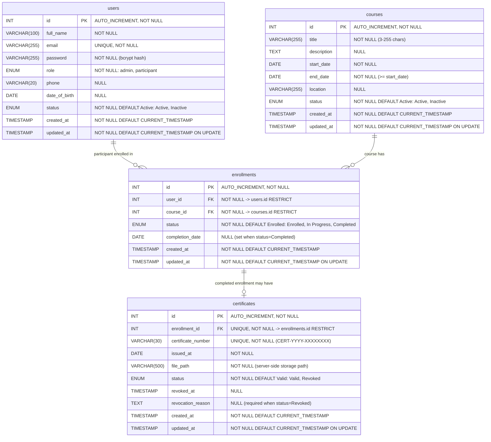

# Database Entity Relationship Diagram
## Training Certificate Management and Archive System

| Field | Value |
|---|---|
| Document ID | ERD-001 |
| Version | 1.0 |
| Related SRS | SRS-001 v1.3 |
| Related BR | BR-001 v1.3 |
| Date | 2026-11-22 |
| Status | Approved for Implementation |

---

## 1. Requirements Baseline Verification

Before producing the diagram, all four source documents were read and verified:

| Document | Version | Status |
|---|---|---|
| `docs/SRS.md` | **1.3** | ✅ Verified |
| `docs/BUSINESS_RULES.md` | **1.3** | ✅ Verified |
| `docs/USE_CASES.md` | **1.3** | ✅ Verified |
| `docs/REQUIREMENTS_TRACEABILITY.md` | **1.3** | ✅ Verified |

All four documents are at Requirements Baseline v1.3. No inconsistencies found. Design proceeds.

---

## 2. Entity Overview

The system requires **four core tables**:

| Table | Purpose |
|---|---|
| `users` | Stores all user accounts (Administrators and Participants) with role discrimination |
| `courses` | Stores all training course records |
| `enrollments` | Records the many-to-many relationship between participants and courses, with status tracking |
| `certificates` | Stores all issued certificate records, linked one-to-one with a completed enrollment |

**No additional tables are required.** The two-role design is best served by a single `users` table with a `role` discriminator column, as the data model for Administrators and Participants is structurally identical (same attributes, same authentication mechanism, different permissions). A separate `roles` table is not warranted for two static roles.

---

## 3. Mermaid ER Diagram

---

## 4. Relationship Descriptions

### 4.1 `users` → `enrollments` (One-to-Many)

- One user (participant) can have zero or many enrollment records.
- Each enrollment belongs to exactly one user.
- **Cardinality:** `users` 1 — 0..N `enrollments`
- **FK on `enrollments.user_id`:** `ON DELETE RESTRICT` — a participant cannot be hard-deleted if enrollment records exist (BR-10, BR-11).
- Note: Only participants (role = `participant`) appear in enrollments. Administrators are never enrolled in courses.

### 4.2 `courses` → `enrollments` (One-to-Many)

- One course can have zero or many enrollment records.
- Each enrollment belongs to exactly one course.
- **Cardinality:** `courses` 1 — 0..N `enrollments`
- **FK on `enrollments.course_id`:** `ON DELETE RESTRICT` — a course cannot be deleted if any enrollment exists (BR-11).

### 4.3 `enrollments` → `certificates` (One-to-One, optional)

- Each enrollment may have at most one certificate (UNIQUE on `certificates.enrollment_id` — BR-03, NFR-26).
- Not all enrollments have certificates (only Completed enrollments are eligible).
- A certificate cannot exist without an enrollment.
- **Cardinality:** `enrollments` 1 — 0..1 `certificates`
- **FK on `certificates.enrollment_id`:** `ON DELETE RESTRICT` — certificate records must never be deleted (BR-09, BR-07).

### 4.4 Cross-table: Participant ↔ Course (Many-to-Many via `enrollments`)

The `enrollments` table is the junction/bridge entity for the many-to-many relationship between users (participants) and courses. The composite UNIQUE constraint on `(user_id, course_id)` enforces the no-duplicate-enrollment rule (BR-01, NFR-27).

---

## 5. Unique Constraints Summary

| Table | Unique Constraint | Business Rule |
|---|---|---|
| `users` | `email` (single column) | BR-12, NFR-31 |
| `enrollments` | `(user_id, course_id)` (composite) | BR-01, NFR-27 |
| `certificates` | `enrollment_id` (single column) | BR-03, NFR-26 |
| `certificates` | `certificate_number` (single column) | BR-04, NFR-25 |

---

## 6. ON DELETE Behavior Summary

| FK Column | References | ON DELETE | Justification |
|---|---|---|---|
| `enrollments.user_id` | `users.id` | RESTRICT | Preserves enrollment history (BR-10 tier 2) |
| `enrollments.course_id` | `courses.id` | RESTRICT | Preserves enrollment history (BR-11) |
| `certificates.enrollment_id` | `enrollments.id` | RESTRICT | Certificates must never be deleted (BR-09) |

> [!IMPORTANT]
> `ON DELETE RESTRICT` is used exclusively. `CASCADE` is never appropriate for this system because historical records (enrollments, certificates) must be permanently preserved regardless of parent record changes.

---

## 7. Status Value Constraints

All status columns use MySQL `ENUM` to enforce valid values at the database level, consistent with the approved Status Value Glossary (BUSINESS_RULES.md):

| Table | Column | Allowed Values | Default |
|---|---|---|---|
| `users` | `status` | `'Active'`, `'Inactive'` | `'Active'` |
| `courses` | `status` | `'Active'`, `'Inactive'` | `'Active'` |
| `enrollments` | `status` | `'Enrolled'`, `'In Progress'`, `'Completed'` | `'Enrolled'` |
| `certificates` | `status` | `'Valid'`, `'Revoked'` | `'Valid'` |
| `users` | `role` | `'admin'`, `'participant'` | (no default — must be explicit) |

---

## 8. Index Plan

| Table | Index | Type | Purpose |
|---|---|---|---|
| `users` | `email` | UNIQUE (implicit index) | Login lookup, uniqueness enforcement |
| `users` | `role` | INDEX | Filter participants vs admins on dashboard |
| `users` | `status` | INDEX | Filter active participants |
| `courses` | `status` | INDEX | Filter active courses |
| `enrollments` | `(user_id, course_id)` | UNIQUE (implicit composite) | Duplicate-enrollment prevention |
| `enrollments` | `user_id` | INDEX (via FK) | List enrollments per participant |
| `enrollments` | `course_id` | INDEX (via FK) | List enrollments per course |
| `enrollments` | `status` | INDEX | Filter by enrollment status |
| `certificates` | `certificate_number` | UNIQUE (implicit index) | Public search, uniqueness enforcement |
| `certificates` | `enrollment_id` | UNIQUE (implicit index) | One-certificate-per-enrollment |
| `certificates` | `status` | INDEX | Filter by certificate status (archive) |

---

*End of Database ERD Document — Version 1.0*
